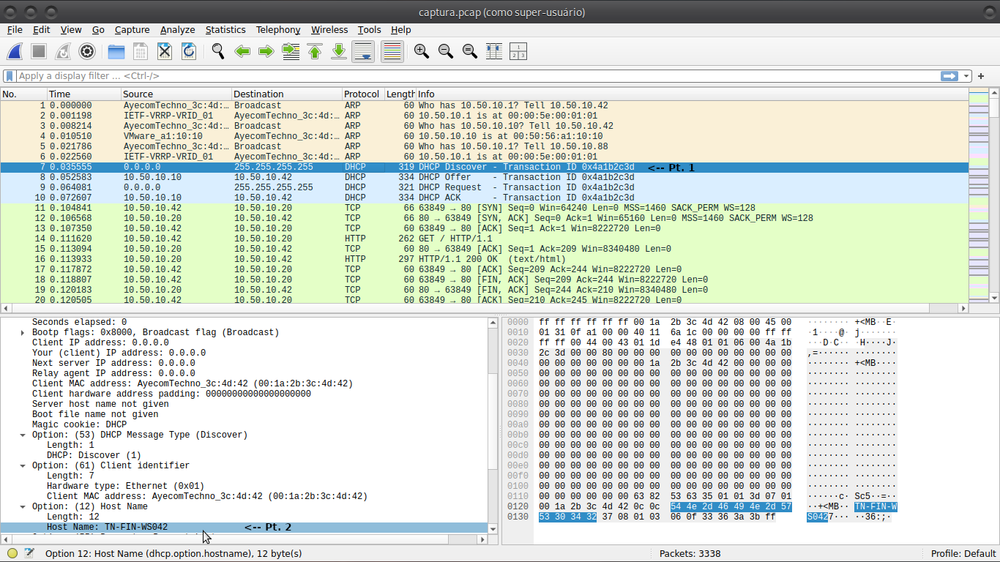
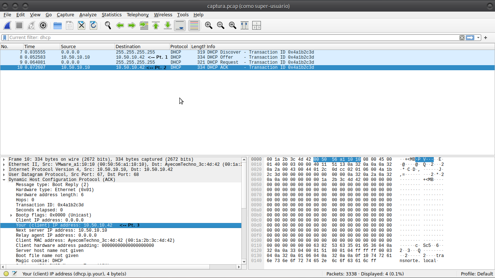
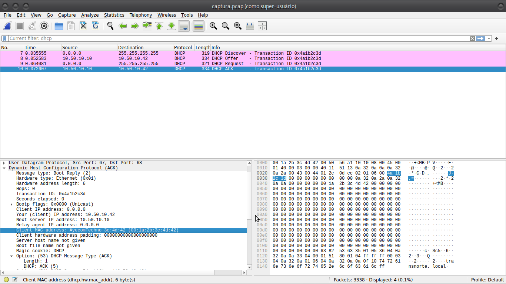
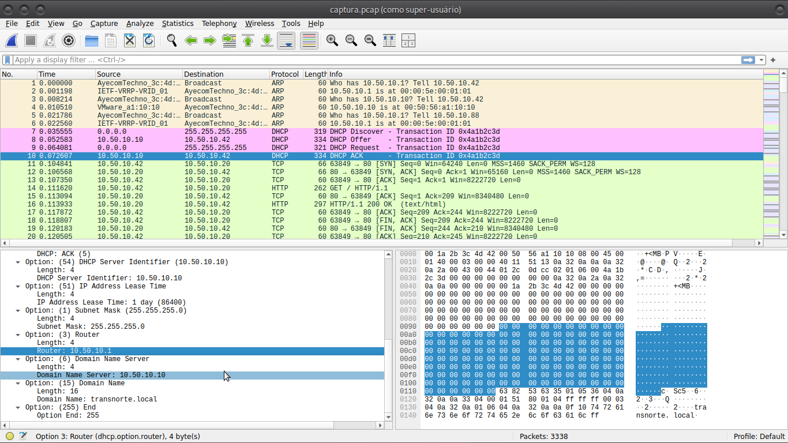
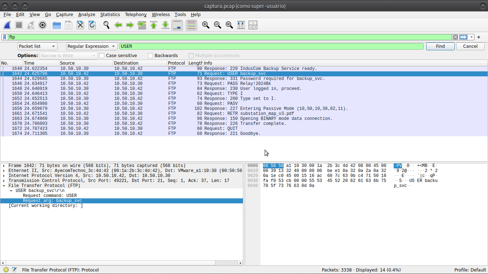
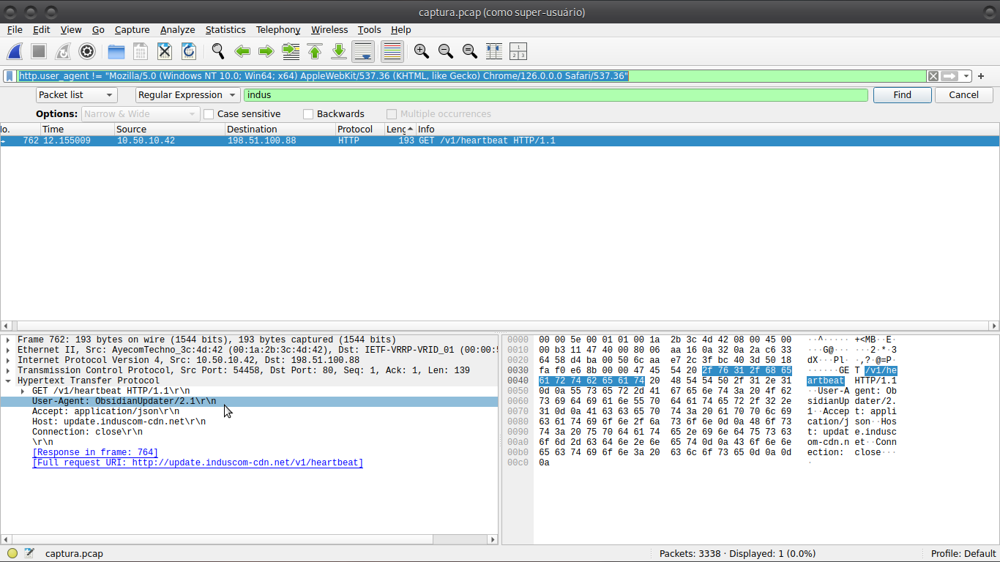
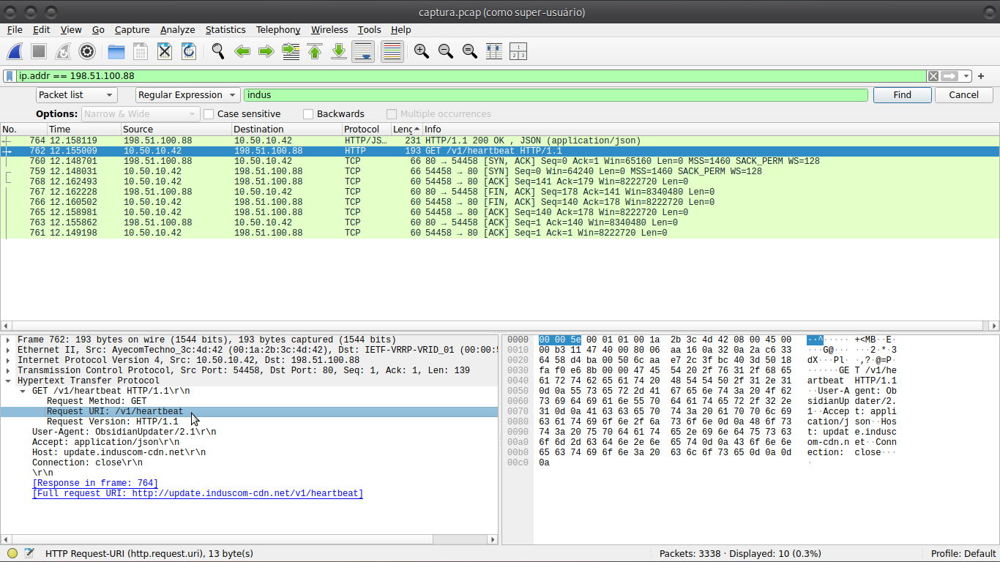
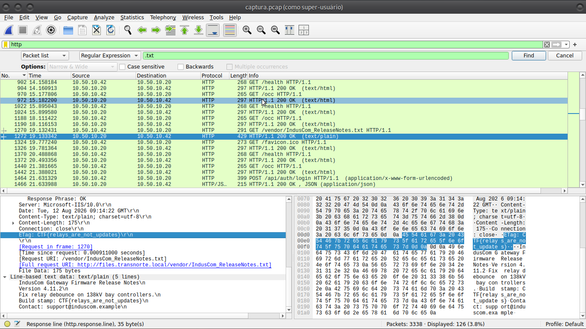
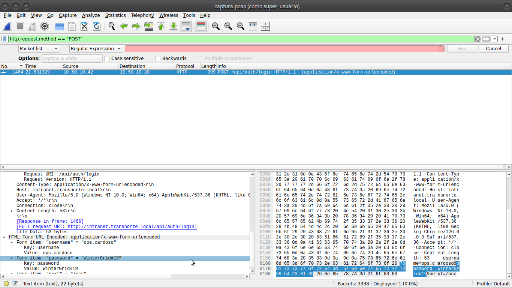

# 🔍 Resolução PCAP: captura.pcap

- **Alvo:** `captura.pcap`
- **Ambiente:** Transnorte / Estação de Finanças (`TN-FIN-WS042`)
- **Status:** Em resolução

---

### 01. Hostname TN-FIN - 10 pts
- **Enunciado:** Qual o hostname enviado pela estação no DHCP?
- **Análise / Resolução:**
  <!-- Explique seu raciocínio, filtro utilizado e insira os prints aqui -->
  Se é o hostname da estação, muito pssivelmente a estação estaria requerendo o endereço IP do Gateway, então basta eu ver quem ta mandando o discover(a seta da pt. 1) e, posteriormente, procuro o hostname(seta da Pt. 2). Nesse caso nao precisei de filtro, pois estava logo no começo mas, caso precise, só pesquisar "dhcp".

  

  Nota: Nesse caso o Host que deseja um IP manda uma msg via brodcast para que o servidor DHCP (Discover) veja e o DHCP oferece(OFFER) um IP livre e o host vai Requerer(REQUEST) este IP oferecido e, por ultimo, o servidor DHCP vai reconhecer(ACK) aquela maquina como dona daquele endereço em questão, é usado como mneumonio *DORA* para esse processo

- **Resposta:** TN-FIN-WS042

---

### 02. Lease TN-FIN - 10 pts
- **Enunciado:** Qual IPv4 a estação recebeu no DHCP ACK (yiaddr)?
- **Análise / Resolução:**
  Caso queira filtrar, mantém no dhcp. Nisso não se precisa nem ir no ACK, no OFFER vemos um endereço que está sendo oferecido à máquina em questão(Pt. 1) mas podemos ver no proprio ACK o mesmo endereço(Pt. 2 e Pt. 3)
  
- **Resposta:** 10.50.10.42

---

### 03. MAC TN-FIN - 10 pts
- **Enunciado:** Qual o MAC da estação 10.50.10.42?
- **Análise / Resolução:**
  Na mesma imagem da evidencia passada, ainda nos pacotes (DORA) do DHCP podemos verificar que existe a informação "Client MAC Address" lá pode ser constatado o endereço MAC da placa do client conforme selecionado na imagem.
  
- **Resposta:** 00:1a:2b:3c:4d:42

---

### 04. Gateway TN-FIN - 10 pts
- **Enunciado:** Qual o gateway anunciado na opção DHCP router?
- **Análise / Resolução:**
  Olhando a evidencia 4, ainda no pacote ACK, podemos ver que na "Option: (3) Router" há o IP de um roteador logo, já temos o gateway que seria 10.50.10.1 e não só ele, como o IP do DNS na "Option: (6) Domain Name Server" e o proprio nome de dominio na "Option: (15) Domain Name"
  
- **Resposta:** 10.50.10.1

---

### 05. DNS TN-FIN - 10 pts
- **Enunciado:** Qual o servidor DNS anunciado no DHCP?
- **Análise / Resolução:**
  Verificando a Evidencia passada, nota-se a opção "Option: (6) Domain Name Server" onde temos o IP do DNS anunciado pelo DHCP que seria 10.50.10.10
  
- **Resposta:** 10.50.10.10

---

### 06. Dominio TN-FIN - 10 pts
- **Enunciado:** Qual o domain name anunciado no DHCP?[cite: 5]
- **Análise / Resolução:**
  Verificando a Evidencia passada, nota-se a opção "Option: (15) Domain Name" que seria o nome do dominio anunciado pelo DHCP
  
- **Resposta:** transnorte.local

---

### 07. User FTP - 10 pts
- **Enunciado:** Usuário da sessão FTP interna.
- **Análise / Resolução:**
  Nesse caso, filtra-se "ftp" não havendo muitas opções não se faz necessario sondar por expressões comuns, mas para esse caso, caso necessário poderia, alem do filtro, pesquisar por "USER" para adiantar. Nesse caso constata-se que o usuário é o backup_svc.

  Nota.: Para as proximas 2 flags vemos que o agente hostil entrou no via FTP com o login do serviço de backup, e baixou os dados da planta de uma subestação (substation_map_v3.pdf)

  
- **Resposta:** backup_svc

---

### 08. Senha FTP - 10 pts
- **Enunciado:** Senha enviada no tráfego FTP.
- **Análise / Resolução:**
  Ainda na mesma imagem de evidencia constatamos a senha do arquivo, com o uso dos mesmos filtros passados e para o caso de muitas opções a se analisar, em vez de "USER" poderia pesquisar por expressões regulares "PASS". Costata-se a senha do backup_svc: Relay!2024Bk

  (Nota: como usei a mesma imagem da evidencia passada, percebe-se pela coluna Info onde se lê: Request: PASS Relay!2024Bk)

  
- **Resposta:** Relay!2024Bk
  
---

### 09. Mapa SE-03 - 10 pts
- **Enunciado:** Qual o arquivo baixado via RETR no FTP?
- **Análise / Resolução:**
  Prosseguindo com a mesma evidencia, verifica-se a existencia de um *Request: RETR* do arquivo *substation_map_v3.pdf* indicando que o agente hostil requeriu esse arquivo via FTP para sua maquina. seguindo a mesma lógica das resoluções 07 e 08 aqui manteria o filtro em FTP e mudaria somente a expressão regular para RETR.

  (Nota: como usei a mesma imagem da evidencia da flag 07. User FTP, percebe-se a flag desse item pela coluna Info, onde se lê	*Request: RETR substation_map_v3.pdf*)

  
- **Resposta:** substation_map_v3.pdf

---

### 10. Host FTP - 10 pts
- **Enunciado:** Qual o IP do servidor FTP?
- **Análise / Resolução:**

  Usando a mesma imagem de evidencia da flag 07. User FTP pode-se extrair do filtro FTP a resposta do servidor FTP em código *220*(ou seja, o servidor está dizendo que está pronto) se ele está respondendo, logo o endereço de fonte(Source) trata-se do proprio endereço ip do servidor FTP que seria *10.50.10.30*

  
- **Resposta:** 10.50.10.30

---

### 11. Atualizador fantasma - 10 pts
- **Enunciado:** Além do Chrome, um agente periódico falava com a CDN da IndusCom como se fosse update, sem cara de navegador. Qual o User-Agent das requisições HTTP periódicas que não são de navegador?
- **Análise / Resolução:**

  Nesse caso para achar esse tal agente periódico, filtro as requisições por http, percebe-se que o enunciado refere-se a um outro tipo de "Navegador", ou melhor, User-Agent. Tendo essa informação em mãos podemos fazer um filtro melhor colocando na barra de pesquisa: 
    *http.user_agent != "Mozilla/5.0 (Windows NT 10.0; Win64; x64) AppleWebKit/537.36 (KHTML, like Gecko) Chrome/126.0.0.0 Safari/537.36"*
  Com isso filtrará somente as operações que *NÃO* foram feitas com os User-Agents de navegadores convencionais, sobrando somente um *GET v1/heartbeat HTTP/1.1* em que o User-Agent se trata do: ObsidianUpdater/2.1

  
- **Resposta:** CTF{ObsidianUpdater/2.1}

---

### 12. CDN falsa - 10 pts
- **Enunciado:** O pulso periódico desse agente ainda denuncia o vhost da CDN no cabeçalho Host. Qual o Host HTTP usado por esse beacon?
- **Análise / Resolução:**

  Com o mesmo filtro da flag anterior[http.user_agent != "Mozilla/5.0 (Windows NT 10.0; Win64; x64) AppleWebKit/537.36 (KHTML, like Gecko) Chrome/126.0.0.0 Safari/537.36"] e, inclusive com na mesma evidencia anterior, teremos um *Host: update.induscom-cdn.net* um pouco abaixo do *User-Agent*

  
- **Resposta:** update.induscom-cdn.net

---

### 13. Heartbeat HTTP - 10 pts
- **Enunciado:** O caminho pedido nesse GET periódico é o heartbeat do canal, não uma página do portal OCC. Qual o URI requisitado no beacon?
- **Análise / Resolução:**
  Ainda na evidencia da *Flag 11. Atualizador Fantasma* teremos como especificar mais os metodos onde se vê o tipo de método(GET), a URI de Request (/v1/heartbeat) e a versão do request (HTTP/1.1), nesse caso a resposta pedida é: /v1/heartbeat. Mesmo se tratando da mesma evidencia, o print será diferente para melhor compreenção

  
- **Resposta:** /v1/heartbeat

---

### 14. Notes HTTP - 10 pts
- **Enunciado:** No mesmo pcap a estação de trabalho baixou as release notes da IndusCom e o corpo desse objeto ainda carrega a marca do caso. Qual a flag no corpo das release notes da IndusCom?
- **Análise / Resolução:**

  Nesta situação fiz de duas formas. A primeira seria por aplicar os filtros por método http:
    *http.request.method == "GET"*
  como pode-se notar na evidencia, o arquivo .txt dos Releases Notes da IndusCom é um dos primeiros na lista então, ao localizá-lo, retiro o filtro, pois não há flag aqui ainda, a unica coisa dita aqui foi "quero esse arquivo /vendor/IndusCom_ReleaseNotes.txt" e não vejo nenhum indicio da flag nesse pacote, ou seja, a flag está na resposta a esse pacote e, no caso se perceber ele é bem maior que os outros pacotes ao verificá-lo achará a flag na *ETag: CTF{relays_are_not_updates}*.

  Nota : Para a segunda forma, seria a forma que procurei no dia do CTF em questão, simplifiquei bastante, com o filtro *http* aplicado, pesquisei nas expressões regulares *.txt* pois eu havia deduzido que podia ser um txt mas, não cheguei a uma conclusão satisfatória ao verificar o pacote e não havia percebido que no pacote posterior estava a flag pois estava distraido com o */vendor/IndusCom_ReleaseNotes.txt* então concluí que por se tratar de um arquivo de texto dentro de um pacote, ele poderia ter um tamanho maior que o convencional, dessa forma, organizei o filtro do protocolo *http* por tamanho. O primeiro de cara era o maior e já tinha a flag e verifiquei o *Content-Type: text/plain; charset=utf-8* e a *Request URI: /vendor/IndusCom_ReleaseNotes.txt* que me indicava que era a flag procurada.

  
- **Resposta (Flag):** `CTF{relays_are_not_updates}`

---

### 15. Inverno na intranet - 10 pts
- **Enunciado:** Houve um POST em claro para o login do OCC e o campo de senha estava no corpo desse pedido. Qual a senha enviada no POST de /api/auth/login?[cite: 5, 14]
- **Análise / Resolução:**

  Nesse caso filtro por método HTTP POST com o filtro a seguir:
    *http.request.method == "POST"*
  Sendo assim há somente uma requisição POST e verificando essa requisição nota-se que é repassado de forma aberta itens de formulario onde o username repassado é *ops.cardoso* e password, que é a nossa flag é *WinterGrid#19*.
  
  
- **Resposta:** WinterGrid#19

---

### 16. TXT backbone - 10 pts
- **Enunciado:** Fora da zona interna, uma resposta TXT de status.litoral-dns.net aparece neste pcap com conteúdo que não é diagnóstico de rede. Qual o conteúdo TXT de status.litoral-dns.net?[cite: 5, 14]
- **Análise / Resolução:**
  
  
- **Resposta (Flag):** `CTF{...}`

---

### 17. Sync vendor - 10 pts
- **Enunciado:** Qual FQDN cdn-sync foi resolvido neste pcap?[cite: 5]
- **Análise / Resolução:**
  
  
- **Resposta:** 

---

### 18. IP do sync - 10 pts
- **Enunciado:** Qual IPv4 foi retornado para cdn-sync.induscom-support.net?[cite: 5]
- **Análise / Resolução:**
  
  
- **Resposta:** 

---

### 19. DNS falastrão - 10 pts
- **Enunciado:** Registro de consulta anômala no DNS.[cite: 5]
- **Análise / Resolução:**
  
  
- **Resposta:** 

---

### 20. SNI TLS TN - 10 pts
- **Enunciado:** Nome TLS/SNI usado no Client Hello da TN-FIN.[cite: 5]
- **Análise / Resolução:**
  
  
- **Resposta:** 

---

### 21. ICMP recado TN - 10 pts
- **Enunciado:** Recado/Flag exfiltrado via Echo ICMP.[cite: 5]
- **Análise / Resolução:**
  
  
- **Resposta (Flag):** `CTF{...}`

---

### 22. Cookie OCC - 10 pts
- **Enunciado:** Cookie de sessão do portal OCC.[cite: 5]
- **Análise / Resolução:**
  
  
- **Resposta:** 

---

### 23. Basic OT - 10 pts
- **Enunciado:** Qual o par usuário:senha do HTTP Basic em tools.transnorte.local?[cite: 5]
- **Análise / Resolução:**
  
  
- **Resposta:** 

---

### 24. Banner OT - 10 pts
- **Enunciado:** Qual o cabeçalho Server HTTP do IndusCom HTTPD?[cite: 5]
- **Análise / Resolução:**
  
  
- **Resposta:** 

---

### 25. WPAD TN - 10 pts
- **Enunciado:** Qual o Host HTTP usado no pedido WPAD?[cite: 5]
- **Análise / Resolução:**
  
  
- **Resposta:** 

---

### 26. Scan interno TN - 10 pts
- **Enunciado:** Qual IP interno enviou SYN para o maior número de portas distintas em 10.50.10.20?[cite: 5]
- **Análise / Resolução:**
  
  
- **Resposta:**